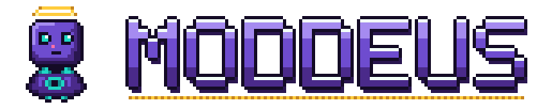

<b>Make Minecraft mods by talking to your game.</b> 
Press <kbd>K</kbd>, say what you want, and it shows up in your world within seconds: no restart, no rejoin.

---

Moddeus is a Fabric mod for **Minecraft 26.3**. It runs [Claude Code](https://claude.com/claude-code) inside your singleplayer world.
Ask for a sword that shoots lightning, a physics playground or a whole mod with its own creative tab, and it writes the
code, textures and sounds and swaps them into the running game.

## What it does
- **Chat in game** (<kbd>K</kbd>): a full Claude Code chat inside Minecraft, with approvals, plans and model and effort pickers.
- **Voice** (hold <kbd>K</kbd>): speak and a fast helper acts at once. Bigger jobs go to the main chat.
- **Live everything**: Java, datapacks, resource packs, blocks, items, mobs, sounds and VFX hot-swap into the open world.
- **Mods screen** (<kbd>G</kbd>): every mod you make is a project you can turn on or off, undo, or delete.
- **The mascot**: a little floating cube-head god that follows you and talks while it works. Tell it to come, stay or spin.
- **Learns from you**: correct it once ("too many particles") and it remembers the rule for every future mod.

## Install
1. Install **Minecraft 26.3** with **Fabric Loader** (any launcher: Modrinth App, Prism, the official launcher + Fabric installer).
2. Drop `moddeus-x.y.z.jar` into the instance's `mods` folder. Fabric API is bundled.
3. Install **Claude Code** and log in once: <https://claude.com/claude-code> (run `claude` in a terminal).
4. Start the game, open a world and press <kbd>K</kbd>.

That's all. Moddeus downloads Node.js by itself if you don't have it. It compiles in game (with the Java compiler bundled
in the jar), so you don't need a JDK, Gradle or an IDE. Your mods live in `~/Moddeus`.

## Good to know
- **It runs on your computer.** Claude Code can read and write files and run commands, and you approve actions in game.
  Use it on a machine and account you're comfortable letting an AI agent work on.
- It uses your own Claude subscription through the normal interactive Claude Code, so there are no API keys.
- Singleplayer only.

## Made with AI
Most of this project, the code and the art included, was written by Claude (Anthropic's AI) through Claude Code, directed and
tested by a human. Expect rough edges, and please report them as issues.

## Building from source
JetBrains Runtime 25 in `.tools/jbr` (for enhanced class redefinition), then `play.bat` (`gradlew runClient`).
`gradlew build` makes the release jar in `build/libs`. Dev notes are in `CLAUDE.md`.

## Not affiliated
Moddeus is a fan project. It is not affiliated with or endorsed by Anthropic or Mojang/Microsoft.
"Claude" and "Claude Code" are trademarks of Anthropic. "Minecraft" is a trademark of Mojang/Microsoft.

## License
MIT, see [LICENSE](LICENSE).
